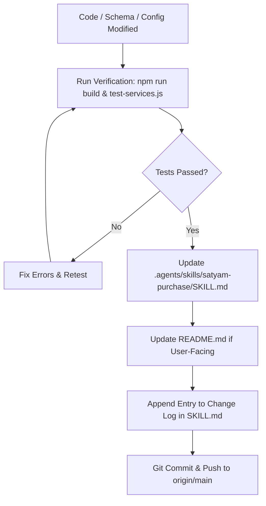

# Satyam Purchase — Domain Knowledge & System Architecture

> [!IMPORTANT]
> **MANDATORY CONTINUOUS AUTO-UPDATE PROTOCOL FOR AGENTS**:
> Whenever ANY change is made to this codebase—including database schema, authentication, API routes, pricing formulas, UI workflows, credentials, or deployment configuration—you **MUST** immediately update this `SKILL.md` file and the project `README.md` to reflect the changes before concluding your turn. Always append an entry to the [Change Log](#6-recent-changes--evolution-log) at the bottom of this file.

---

## 1. Domain & Business Overview

**Satyam Purchase** is an enterprise agricultural commodity procurement and pricing management platform operated by **Satyam Agrocot**. The platform automates and governs grain procurement operations across decentralized mandi centres, warehouse weighbridge facilities, and processing plants.

### Commodities & Quality Thresholds
- **Maize (मक्का)**:
  - Base Moisture Standard: `14.0%`
  - Deduction Type: `wt` (1% weight reduction per 1% excess moisture)
  - Maximum Allowable Moisture: `18.0%` (Purchases with moisture > 18.0% are **strictly blocked**)
- **Chickpea (चना)**:
  - Base Moisture Standard: `12.0%`
  - Deduction Type: `rs` (₹30/qtl price deduction per 1% excess moisture)
  - Maximum Allowable Moisture: `14.0%` (Purchases with moisture > 14.0% are **strictly blocked**)
- **Grades**: `Grade A`, `Grade B`, `Grade C` (distinct quality benchmarks, plant delivered prices, and freight slabs).

### Procurement Centres
- Active centres: Diwal (`DWL`), Sample Centre 2 (`SC2`), Sample Centre 3 (`SC3`), Sample Centre 4 (`SC4`), Sample Centre 5 (`SC5`).
- Each centre has configurable shortage factors (e.g. 0.5% = `0.005`), local expense schedules, and profit margin overrides.

---

## 2. Core Pricing & Mathematical Formulas

### A. Reverse Ceiling Price Formula
Calculates the maximum purchase rate a field officer can offer a farmer at the local mandi to safeguard target profit margins:

$$T = \text{PlantPrice}(\text{Commodity}, \text{Grade}) - \text{ProfitMargin}(\text{Centre})$$

$$\text{PctExpenses} = \frac{\sum \text{Percentage Expenses}}{100} \quad (\text{e.g., Mandi Fee 1.7\%} + \text{Commission 3.0\%})$$

$$\text{FixExpenses} = \sum \text{Fixed ₹/qtl Expenses} \quad (\text{Hammali} + \text{Transit} + \text{Loading} + \text{Bags} + \text{Freight})$$

$$\text{Base Ceiling } P = \frac{T \times (1 - \text{Shortage Factor}) - \text{FixExpenses}}{1 + \text{PctExpenses}}$$

### B. Moisture Penalty Deduction
- Moisture $m \le \text{Base}$: Deduction $= 0$.
- Excess Moisture $\Delta m = m - \text{Base}$ (where $m \le \text{Max}$):
  - Weight Deduction (`dedType == 'wt'`): $\text{Penalty} = P \times \left(\frac{\text{dedRate} \times \Delta m}{100}\right)$
  - Price Deduction (`dedType == 'rs'`): $\text{Penalty} = \text{dedRate} \times \Delta m$
- Net Offering Ceiling Rate $= P - \text{Penalty}$.
- If $m > \text{Max}$: Deal creation is **strictly blocked**.

### C. Field Officer Commission Flexibility
- Authorized officers (`can_cut_comm: true`) can reduce commission below standard (e.g., from 3.0% down to 2.0% or 1.0%).
- Lowering commission directly reduces $\text{PctExpenses}$, elevating the base ceiling price to allow competitive procurement during aggressive mandi bidding.

### D. Warehouse Weighbridge Settlement
1. $\text{Net Weight} = \text{Gross Weight} - \text{Tare Weight}$
2. Final warehouse moisture $fm$ measured upon unloading:
   $$\text{Extra Moisture} = \max(0, fm - \max(\text{Base}, \text{SodaMoisture}))$$
3. Rate settlement:
   - Weight Deduction: $\text{Final Rate} = \text{Agreed Rate} \times \left(1 - \frac{\text{dedRate} \times \text{Extra Moisture}}{100}\right)$
   - Price Deduction: $\text{Final Rate} = \text{Agreed Rate} - (\text{dedRate} \times \text{Extra Moisture})$
4. Total Payout $= \text{Final Rate} \times \text{Net Weight}$.

---

## 3. Role-Based Access Control (RBAC) & Security Specification

The application enforces dedicated workspaces and permission boundaries for 4 distinct operational roles:

| Role | Role Name | Centre Scope | Responsibilities & Authorized Views |
| :--- | :--- | :--- | :--- |
| **Admin** | Purchase Head | All Centres (`ALL`) | - **Approvals**: Approve/reject over-ceiling and over-quota lots; authorize final rates for unloaded lots. - **Price Masters**: Real-time plant delivered price publisher with version history; edit expense templates and margins. - **Daily Quotas**: Set and enforce daily purchase volume limits (qtl) per centre and commodity. - **User Management**: Create/edit users, assign roles, toggle commission reduction permissions, deactivate users. - **Procurement Ledger**: Full cross-centre lot search, filtering, and audit log inspection. - **Analytics**: Cross-centre inventory, freight variance, spend analysis. |
| **Officer** | Field Officer | Assigned Centre (`DWL`, `SC2`, etc.) | - **Ceiling Calculator**: Real-time rate calculator with Hindi labels ("भाव कैसे बना"), moisture deduction preview, commission adjustment. - **New Soda**: Farmer details entry, quota limit validation, material photo capture, instant WhatsApp deal share cards. - **My Sodas**: Real-time status tracking for centre deals. |
| **Warehouse** | Warehouse In-charge | Assigned Centre (`DWL`, etc.) | - **Unload & Weigh**: Search confirmed incoming sodas, record weighbridge gross and tare weights, enter final moisture, attach slip photo/PDF. - **Dispatch**: Record outbound plant dispatches, vehicle tracking, freight variances, maintain live physical stock-in-hand. - **Centre Sodas**: Monitor lot progress. |
| **Accounts** | Accounts & Finance | All Centres (`ALL`) | - **Financial Dashboard**: Procurement spend, pending liability, freight variances, volume summaries. - **Ledger**: Complete cross-centre audit ledger with multi-parameter filtering. - **Export**: 1-click Copy as CSV / Excel export for accounting reconciliation. |

### Authentication & Role Switching Security Rules
1. **Strict User ID & Password Authentication**:
   - Mobile number / OTP authentication is **completely disabled**.
   - Sign-in requires `User ID (Username)` and `Password`.
   - Authentication backend query verifies `LOWER(login_id) = $1 AND password = $2 AND active = true`.
2. **Role Switching Privilege Isolation**:
   - **Admin** (`role === 'Admin'`) possesses master switching privileges and can switch to any role workspace immediately without password verification.
   - **Non-admin roles** (Field Officer, Warehouse, Accounts) cannot switch roles freely. Attempting to switch triggers `RoleSwitchModal.jsx`, requiring the target role's password or the master Admin password.
   - Verified via `POST /api/auth/verify-role`.

### Default Credentials Matrix

| Role | Name | User ID | Password | Centre Scope | Privileges |
| :--- | :--- | :--- | :--- | :--- | :--- |
| **Admin** | Avi Mangal | `admin` | `admin123` | All Centres (`ALL`) | Full administrative authorization & master data control |
| **Field Officer** | Rahul | `officer_dwl` | `officer123` | Diwal (`DWL`) | Authorized to reduce commission for competitive bidding |
| **Warehouse** | Suresh | `warehouse_dwl` | `warehouse123` | Diwal (`DWL`) | Weighbridge intake, slip uploads, plant dispatches |
| **Accounts** | Accounts Sample | `accounts` | `accounts123` | All Centres (`ALL`) | Financial auditing, valuation, and Excel export |
| **Field Officer** | SC2 Officer | `officer_sc2` | `officer123` | Sample Centre 2 (`SC2`) | Standard commission procurement only |

---

## 4. Backend & Database Architecture

### Neon Lakebase Postgres Service
- **Engine**: PostgreSQL 18.6 connected via `@neondatabase/serverless`.
- **Branch**: `production` (Project ID: `rough-truth-56957182`, Org: `org-silent-truth-74019802`).
- **Connection Configuration**:
  - `DATABASE_URL`: Pooled connection string for serverless API endpoints.
  - `DATABASE_URL_UNPOOLED`: Direct connection string for DDL migrations.
- **Database Tables**:
  - `users`: `id`, `name`, `login_id`, `password`, `mobile`, `role`, `centre`, `active`, `can_cut_comm`, `last_login`, `created_at`.
  - `plant_prices`: `id`, `commodity`, `grade`, `price`, `target_margin`, `updated_at`, `updated_by`.
  - `daily_limits`: `id`, `centre`, `commodity`, `quota_limit`, `date`, `updated_at`.
  - `sodas`: Full procurement records with farmer details, moisture, rates, status (`PendingApproval`, `Confirmed`, `Unloaded`, `Cancelled`), photos, and weighbridge data.
  - `dispatches`: Outbound plant dispatches, truck numbers, net weight, estimated vs actual freight.
  - `activity_logs`: Audit trail recording `user_name`, `action`, `details`, `created_at`.

### Neon Auth Service
- Managed Better Auth deployed on AWS with EdDSA JWKS endpoints:
  - Auth URL: `https://ep-bitter-breeze-aryqw3hj.neonauth.c-4.us-west-2.aws.neon.tech/neondb/auth`
  - JWKS Endpoint: `.../neondb/auth/.well-known/jwks.json`

### Unified API Handlers (`api/index.js` & `server/db.js`)
- `GET /api/health`: Database connectivity, version, server timestamp.
- `POST /api/auth/login`: Authenticate by `userId` and `password`.
- `POST /api/auth/verify-role`: Validate role-switch authorization.
- `GET /api/users` & `POST /api/users`: Retrieve or upsert user accounts.
- `POST /api/users/:id/toggle`: Activate/deactivate user accounts.
- `GET /api/plant-prices` & `POST /api/plant-prices`: Price master read/update.
- `GET /api/daily-limits` & `POST /api/daily-limits`: Daily quota limits.
- `GET /api/sodas`, `POST /api/sodas`, `POST /api/sodas/:id/status`, `POST /api/sodas/:id/unload`: Soda lifecycle.
- `GET /api/dispatches` & `POST /api/dispatches`: Plant dispatch tracking.
- `GET /api/activity-logs`: Activity audit log.

---

## 5. Mandatory Agent Protocol: Auto-Update After Each Change

Whenever you work on this codebase, you must follow this strict checklist before completing your task:

### Self-Update Checklist:
1. **Schema & Models**: If tables, columns, or data structures changed, update Section 4.
2. **Auth & Credentials**: If login methods, passwords, or permissions changed, update Section 3.
3. **Pricing / Math**: If ceiling, penalty, or shortage formulas changed, update Section 2.
4. **API Routes**: If endpoints or payloads changed, update Section 4.
5. **Change Log**: Add date, author, and description in Section 6 below.

---

## 6. Recent Changes & Evolution Log

- **2026-10-16 (Architecture Documentation)**:
  - Created comprehensive system architecture reference document ([`ARCHITECTURE.md`](file:///Users/mahatvagarg/Documents/GitHub/satyam%20purchase/ARCHITECTURE.md)) detailing client-server data flows, component hierarchy, entity-relationship models, sequence diagrams for authentication and role switching, and calculation engines.
- **2026-10-16**:
  - Implemented mandatory Continuous Auto-Update Protocol for Antigravity agents in `SKILL.md` and `AGENTS.md`.
  - Removed all mobile/OTP login flows; enforced pure User ID (Username) + Password authentication across frontend and backend.
  - Implemented role-switch security modal (`RoleSwitchModal.jsx`): Admin switches instantly; all other roles require password verification.
  - Provisioned Neon Lakebase Postgres (v18.6) and Neon Auth; seeded live users and plant pricing.
  - Converted prototype HTML into full React + Vite application with 4 distinct RBAC portals (Admin, Officer, Warehouse, Accounts).
  - Configured Vercel serverless integration and pushed codebase to `https://github.com/mahatva/satyam-purchase.git`.
