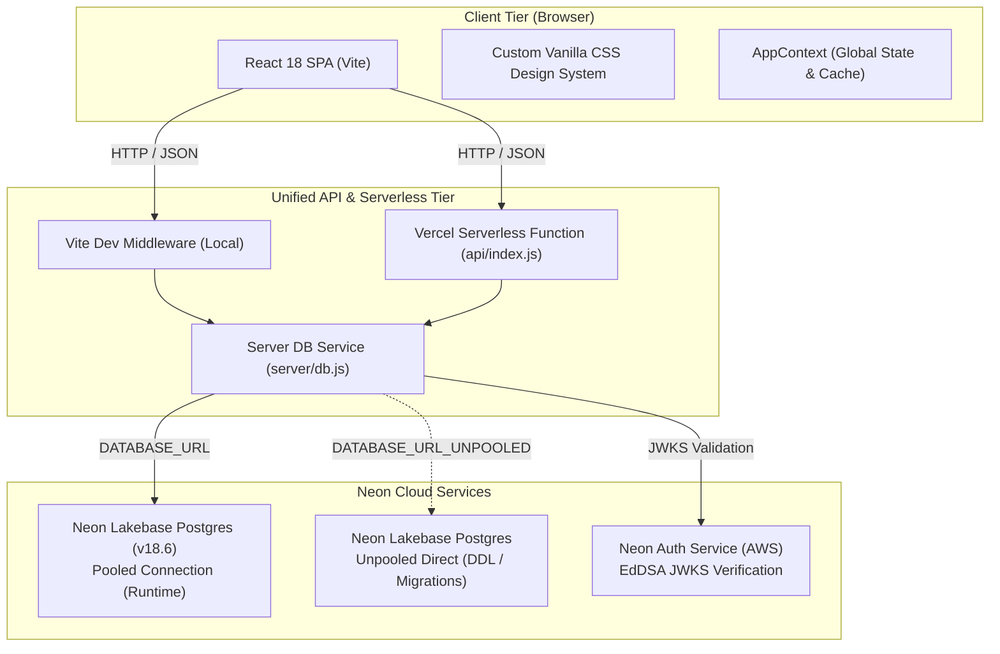
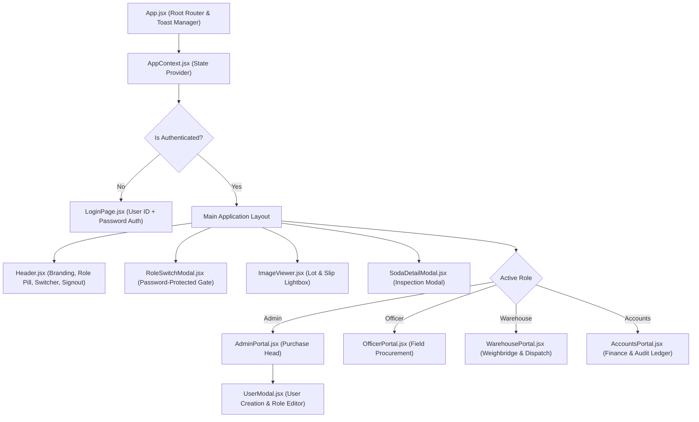
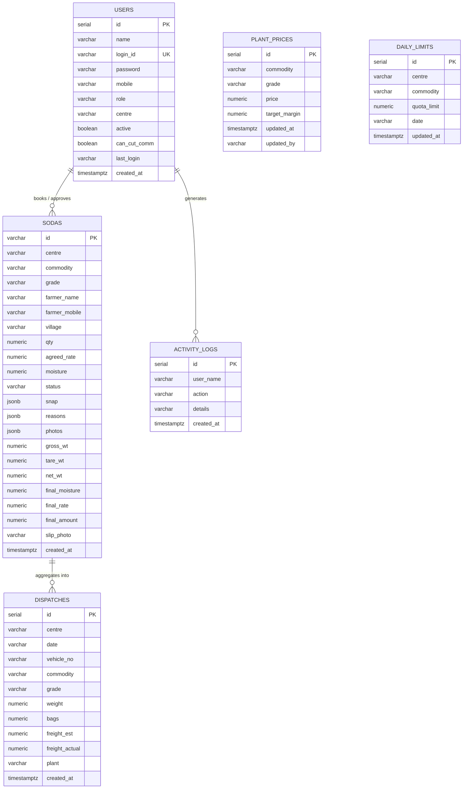
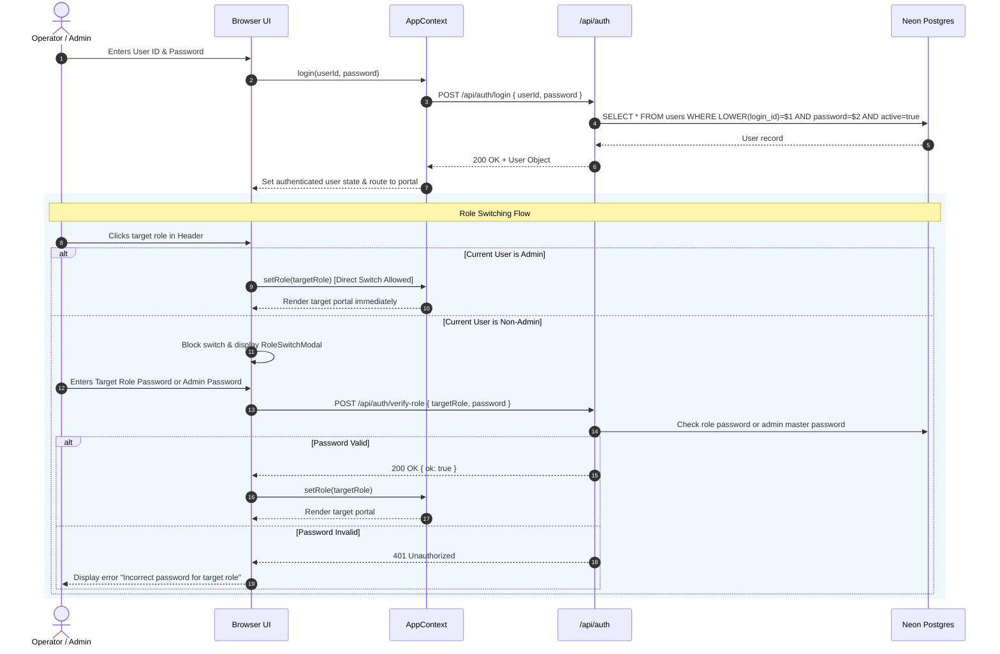

# Satyam Purchase — System Architecture Document

This document provides a comprehensive technical breakdown of the architecture, data models, component hierarchy, security protocols, and operational workflows of the **Satyam Purchase** platform.

---

## 1. High-Level System Architecture

Satyam Purchase is engineered as a modern, serverless cloud application with a decoupled client-server architecture:



### Architectural Highlights
1. **Frontend**: Vite + React 18 Single Page Application (SPA) designed with a hand-crafted Vanilla CSS design system for ultra-fast rendering, fluid micro-animations, and responsive layout across mobile and desktop devices.
2. **API Layer**: Single unified entry point ([`api/index.js`](file:///Users/mahatvagarg/Documents/GitHub/satyam%20purchase/api/index.js)) executing identically in local development (via Vite dev server middleware in `vite.config.js`) and in production (as a Vercel Serverless Node.js function).
3. **Database Tier**: Managed **Neon Lakebase Postgres** (PostgreSQL 18.6) providing instant serverless scaling, branch isolation, and connection pooling.
4. **Authentication Tier**: Managed **Neon Auth** with cryptographic JSON Web Key Set (JWKS) validation alongside local password hashing.

---

## 2. Frontend Component Hierarchy & RBAC Workspaces

The user interface dynamically constructs dedicated workspaces depending on the authenticated role:



### Role Portal Responsibilities

| Role Portal | Key Capabilities | Restricted Scope |
| :--- | :--- | :--- |
| **AdminPortal** | Over-ceiling lot approvals, over-quota approvals, published plant delivered prices with revision tracking, centre daily quota matrix, user management with permission assignment, cross-centre ledger search, audit log. | Full Administrative access (`ALL` centres). |
| **OfficerPortal** | Interactive reverse ceiling calculator ("भाव कैसे बना"), live moisture deduction preview, commission tuning (if permitted), deal creation with quota checks, WhatsApp deal summary generation. | Scoped strictly to the officer's assigned centre (e.g., `DWL`, `SC2`). |
| **WarehousePortal** | Real-time intake queue, gross and tare weight entry, final moisture analysis with automatic penalty calculation, slip photo upload, outbound plant dispatches, physical stock reconciliation. | Scoped strictly to the warehouse facility centre (e.g., `DWL`). |
| **AccountsPortal** | Financial dashboard (gross procurement spend, pending liabilities, freight variance), full transaction audit ledger with date and status filters, 1-Click Copy / Download CSV export. | Global financial view (`ALL` centres). |

---

## 3. Database Schema & Entity Relationships

The relational model is hosted in Neon Lakebase Postgres under database `neondb`:



### Table Specifications
1. **`users`**: Stores system operators. Uses unique `login_id` for authentication, role assignments (`Admin`, `Officer`, `Warehouse`, `Accounts`), centre scope (`ALL` or specific centre code like `DWL`), and fine-grained authorization flags (e.g., `can_cut_comm`).
2. **`plant_prices`**: Ground-truth delivered pricing at the processing plant per commodity (`Maize`, `Chickpea`) and grade (`Grade A`, `Grade B`, `Grade C`). Serves as the origin for all reverse ceiling price calculations.
3. **`daily_limits`**: Operational risk controls defining the maximum procurement quota (quintals) permitted per centre, commodity, and date.
4. **`sodas`**: Core transactional record representing purchase deals from initial field contract through weighbridge unloading, moisture deduction, and financial approval.
5. **`dispatches`**: Records freight transfer of bulk commodities from local warehouse storage to the central processing plant.
6. **`activity_logs`**: Immutable audit log capturing user events, rate revisions, user modifications, and lot approvals.

---

## 4. Authentication & Role Switch Security Architecture



### Security Directives
- **Zero Mobile / OTP Login**: All authentication requires deterministic `User ID (Username) + Password` verification.
- **Admin Master Switching**: Users with `role === 'Admin'` can switch to any role seamlessly for administrative oversight.
- **Non-Admin Privilege Isolation**: Non-admin operators cannot elevate privileges or inspect other role portals without explicit password authorization.

---

## 5. Pricing & Settlement Calculation Engine

The mathematical logic resides in [`src/utils/calculations.js`](file:///Users/mahatvagarg/Documents/GitHub/satyam%20purchase/src/utils/calculations.js) and is mirrored in backend approval evaluations:

### Reverse Ceiling Price Calculation
```
Target Realization (T) = Plant Delivered Price - Target Profit Margin
Base Ceiling (P)       = (T * (1 - Shortage Factor) - Fixed Expenses) / (1 + Percentage Expenses)
```

Where:
- `Percentage Expenses` = Mandi Tax + Mandi Cess + Commission (default 3.0%, adjustable down to 1.0% by authorized officers).
- `Fixed Expenses` = Hammali + Transit + Loading + Bags + Freight.
- `Shortage Factor` = Centre transit weight loss factor (e.g., 0.5% = 0.005).

### Moisture Deduction Matrix
- **Maize**: Base = `14.0%`, Deduction = `1.0% weight penalty per 1.0% excess moisture`, Max Limit = `18.0%`.
- **Chickpea**: Base = `12.0%`, Deduction = `₹30/qtl price penalty per 1.0% excess moisture`, Max Limit = `14.0%`.

### Final Weighbridge Settlement
Upon delivery at the warehouse:
1. `Net Weight = Gross Weight - Tare Weight`
2. `Extra Moisture = max(0, Final Moisture - max(Base Moisture, Field Agreement Moisture))`
3. Rate adjustment:
   - Weight deduction: `Final Rate = Agreed Rate * (1 - (dedRate * Extra Moisture / 100))`
   - Price deduction: `Final Rate = Agreed Rate - (dedRate * Extra Moisture)`
4. `Total Lot Payable = Final Rate * Net Weight`

---

## 6. Deployment & Environment Architecture

### Environments
- **Local Development**:
  - Runtime: Node.js `>=20.19.0`
  - Server: Vite dev server with custom API routing middleware
  - Command: `npm run dev` (running on `http://localhost:5173/`)
- **Production (Vercel)**:
  - Runtime: Vercel Edge & Node.js Serverless Function
  - Routing: Configured via [`vercel.json`](file:///Users/mahatvagarg/Documents/GitHub/satyam%20purchase/vercel.json) rewrite rules redirecting client navigation to `index.html` and `/api/*` to the serverless function.
  - Command: `vercel --prod`

### Neon Database Provisioning
- Managed via `neon` CLI (`neon deploy`).
- Environment variables configured in `.env.local`:
  - `DATABASE_URL`: Serverless pooled connection string.
  - `DATABASE_URL_UNPOOLED`: Direct connection string for DDL schema setups.
  - `NEON_AUTH_BASE_URL`: Better Auth service URL.
